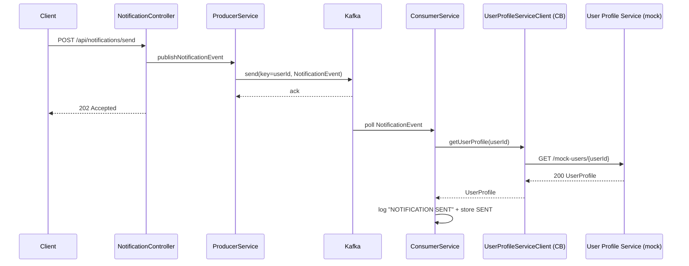
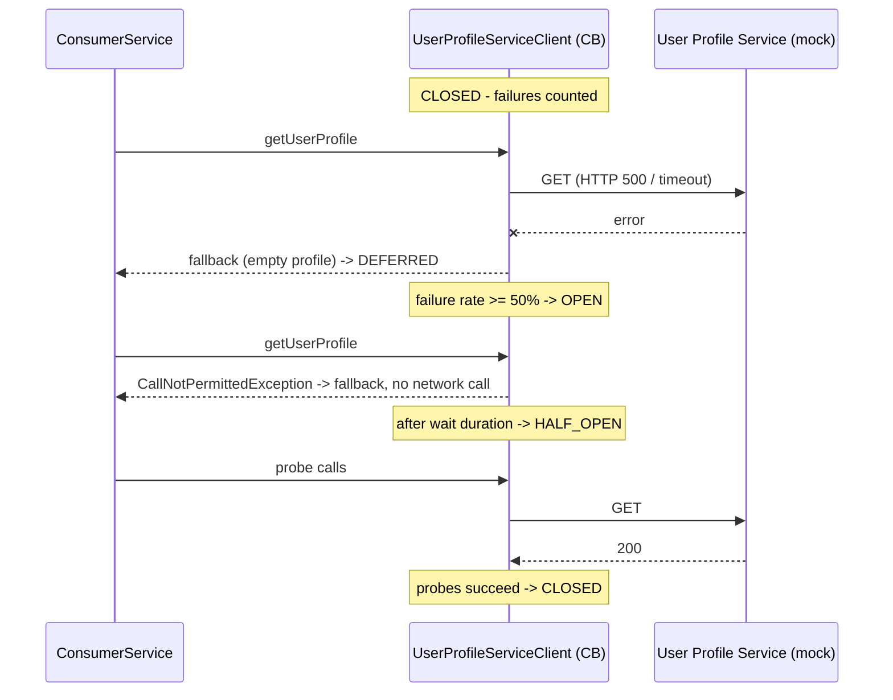
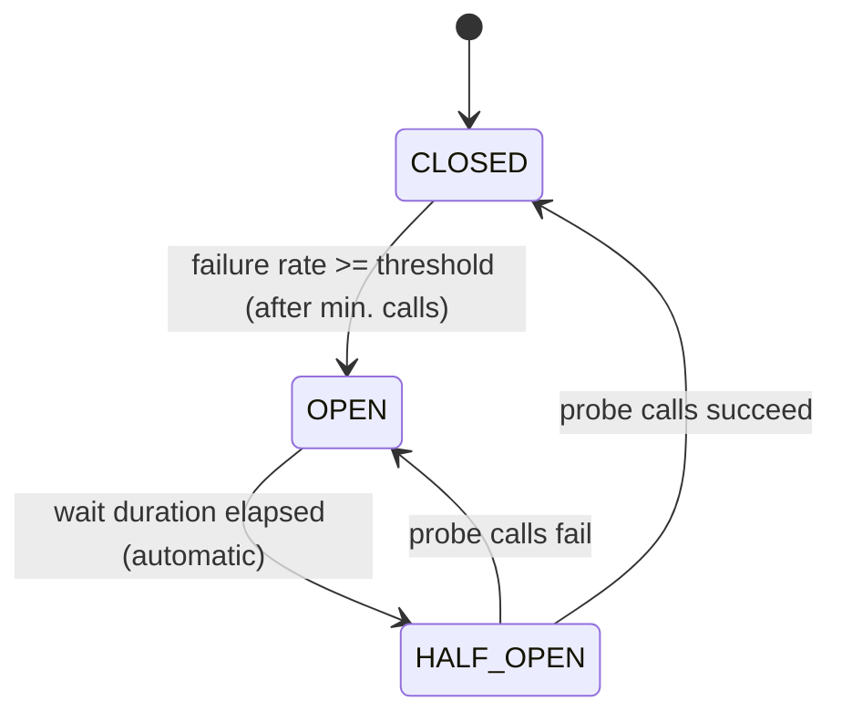

# Architecture

## Components

| Component | Responsibility |
|---|---|
| `NotificationController` | `POST /api/notifications/send`: validates input, delegates to the producer, returns `202` |
| `NotificationProducerService` | Builds `NotificationEvent` (UUID, timestamp), publishes to `notification_events` keyed by `userId`, waits for broker ack |
| `NotificationConsumerService` | `@KafkaListener`; idempotency check, calls the client, records `SENT` / `DEFERRED` |
| `UserProfileServiceClient` | `RestTemplate` call protected by `@CircuitBreaker`; fallback returns an empty profile |
| `MockUserProfileServiceController` | Simulated external service with `fail` / `delay` controls |
| `NotificationStore` | Bounded in-memory store of records and processed event ids |
| `KafkaConfig` | Topic declaration and consumer error handler (exponential back-off) |
| `CircuitBreakerEventLogger` | Logs breaker state transitions |

## Sequence: happy path

## Sequence: User Profile Service down

## Circuit breaker state machine

## Delivery guarantees and failure handling

| Situation | Behaviour |
|---|---|
| Kafka down while publishing | Producer retries (`acks=all`, idempotent). After the delivery timeout the API answers `503`; nothing is accepted silently |
| Kafka down while consuming | Client reconnects with back-off; the listener keeps polling and resumes automatically; offsets are only committed after processing |
| Consumer redelivery | Processed `eventId`s are remembered → duplicates are skipped (idempotent consumer) |
| Poison message / listener exception | Retried with exponential back-off (3 attempts by default), then logged and skipped |
| Undeserialisable payload | `ErrorHandlingDeserializer` turns it into a handled error instead of an endless poll loop |
| User Profile Service failing/slow | Timeout + breaker + fallback → `DEFERRED` record; REST API unaffected |

## Known limitations / next steps

* The notification store is in memory (as allowed by the task). A persistent outbox/DB would survive restarts.
* `DEFERRED` notifications are recorded but not re-driven. A scheduled job or a retry topic (`notification_events.retry`)
  with a dead-letter topic would complete the pattern.
* The consumer idempotency cache is per instance; with several instances use a shared store (e.g. Redis/DB unique key).
* Single broker / single partition defaults are for local development only. Increase partitions and replication for production.
