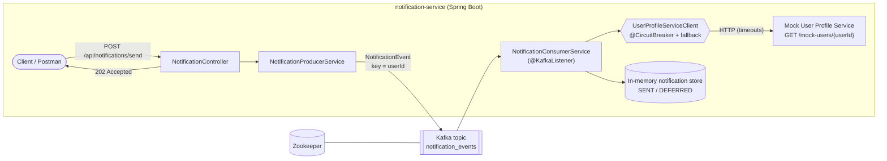

# Resilient Notification Service

An event-driven **Notification Service** built with **Java 17 / Spring Boot 3**, **Apache Kafka** and the
**Resilience4j Circuit Breaker**. Clients submit notification requests over REST; the service queues them
in Kafka, a consumer enriches each one with contact details from a (simulated) **User Profile Service**,
and "sends" the notification. When the User Profile Service is slow or down, the circuit breaker fails fast
and a fallback defers the notification instead of cascading the failure through the system.

## Table of contents
1. [Technologies](#technologies)
2. [Architecture](#architecture)
3. [Quick start (Docker Compose)](#quick-start-docker-compose)
4. [API documentation](#api-documentation)
5. [How to test the Circuit Breaker](#how-to-test-the-circuit-breaker)
6. [Configuration](#configuration)
7. [Running tests](#running-tests)
8. [Running without Docker](#running-without-docker)
9. [Technical decisions](#technical-decisions)
10. [Project structure](#project-structure)

## Technologies

| Area | Choice |
|---|---|
| Language / framework | Java 17, Spring Boot 3.2 (Web, Validation, Actuator, AOP) |
| Messaging | Apache Kafka (Spring for Apache Kafka), Zookeeper |
| Resilience | Resilience4j 2.2 (`resilience4j-spring-boot3`, `resilience4j-micrometer`) |
| Build | Maven |
| Containers | Docker, Docker Compose |
| Tests | JUnit 5, Mockito, AssertJ, Awaitility, Spring Kafka `@EmbeddedKafka` |

## Architecture



**Flow**

1. `POST /api/notifications/send` validates the request, publishes a `NotificationEvent` (key = `userId`) to the
   `notification_events` topic, waits for the broker acknowledgement and returns **202 Accepted**.
2. The Kafka consumer (same service, group `notification_group`) reads the event.
3. It calls the User Profile Service through `UserProfileServiceClient`, which is guarded by a circuit breaker.
4. **Success** → a notification record is logged ("NOTIFICATION SENT") and stored in memory.
   **Failure / breaker OPEN** → the fallback logs *"Circuit Breaker open, notification deferred"* and returns an
   empty profile; the notification is recorded as `DEFERRED`.

More detail: [ARCHITECTURE.md](ARCHITECTURE.md).

## Quick start (Docker Compose)

Prerequisites: Docker with Compose v2 (about 4 GB RAM available to Docker).

```bash
# (optional) customise settings
cp .env.example .env

# build the image and start Zookeeper, Kafka and the service in the background
docker compose up --build -d

# follow the application logs
docker compose logs -f notification-service

# check health (wait ~30-60 s on first start)
curl http://localhost:8080/actuator/health
# {"status":"UP", ...}
```

Send your first notification:

```bash
curl -i -X POST http://localhost:8080/api/notifications/send \
  -H "Content-Type: application/json" \
  -d '{"userId":"user123","message":"Your order has shipped!","notificationType":"EMAIL"}'
```

Shut down:

```bash
docker compose down        # stop and remove containers
docker compose down -v     # ...and also remove volumes
```

## API documentation

### `POST /api/notifications/send`

Queues a notification for asynchronous processing.

**Request body** (`application/json`)

| Field | Type | Rules |
|---|---|---|
| `userId` | string | required, not blank |
| `message` | string | required, not blank |
| `notificationType` | string | required, one of `EMAIL`, `SMS`, `PUSH` |

```json
{ "userId": "user123", "message": "Your order has shipped!", "notificationType": "EMAIL" }
```

**Responses**

| Status | Meaning | Body |
|---|---|---|
| `202 Accepted` | Event stored in Kafka, processing happens asynchronously | `Notification request received and queued for processing.` |
| `400 Bad Request` | Validation failed or malformed JSON | `{"status":400,"error":"Validation failed","details":{"notificationType":"notificationType must be one of EMAIL, SMS, PUSH"}}` |
| `503 Service Unavailable` | Kafka unavailable (producer retries exhausted); nothing was queued, safe to retry | `{"status":503,"error":"Message broker unavailable, ..."}` |

### Supporting endpoints

| Endpoint | Purpose |
|---|---|
| `GET /api/notifications/records[?userId=]` | In-memory records of processed notifications (`SENT` / `DEFERRED`) - useful for demos |
| `GET /mock-users/{userId}[?fail=true][&delay=ms]` | The simulated User Profile Service |
| `POST /mock-users/admin/config?fail=true&delay=0` | Change the mock's behaviour **globally** at runtime (also affects the Kafka consumer's calls) |
| `GET /mock-users/admin/config` | Show current mock behaviour and call count |
| `GET /actuator/health` | Health check (`UP`), includes circuit breaker info |
| `GET /actuator/circuitbreakers` | Current state of the `userProfileService` breaker |
| `GET /actuator/circuitbreakerevents` | Recent breaker events (successes, errors, state transitions) |

A ready-made [Postman collection](postman/notification-service.postman_collection.json) covers all of these.

## How to test the Circuit Breaker

Default breaker settings (all in `application.yml`, overridable via env vars): sliding window of **10** calls,
evaluated after at least **5** calls, opens at **≥ 50 % failures**, stays OPEN for **10 s**, then allows **3** probe
calls in HALF_OPEN. A call that takes longer than the 2 s read timeout counts as a failure.

Open a second terminal and watch the breaker:

```bash
docker compose logs -f notification-service | grep -E "CIRCUIT BREAKER|Circuit Breaker|NOTIFICATION"
```

### 1. CLOSED - normal operation

```bash
curl -s -X POST localhost:8080/api/notifications/send -H 'Content-Type: application/json' \
  -d '{"userId":"alice","message":"Hello","notificationType":"EMAIL"}'
curl -s localhost:8080/actuator/circuitbreakers | jq '.circuitBreakers.userProfileService.state'
# "CLOSED"
```
Log: `NOTIFICATION SENT (simulated) -> type=EMAIL, user=alice, email=alice@example.com, ...`

### 2. Trip the breaker → OPEN

Make the User Profile Service return HTTP 500 and send at least 5 notifications:

```bash
curl -s -X POST 'localhost:8080/mock-users/admin/config?fail=true'

for i in 1 2 3 4 5 6; do
  curl -s -X POST localhost:8080/api/notifications/send -H 'Content-Type: application/json' \
    -d "{\"userId\":\"bob$i\",\"message\":\"msg $i\",\"notificationType\":\"SMS\"}"; echo
done
```

Expected log (illustrative):

```
WARN  [CIRCUIT BREAKER] 'userProfileService' state transition: CLOSED -> OPEN
WARN  Circuit Breaker open, notification deferred (user: bob6) - failing fast without a network call
WARN  NOTIFICATION DEFERRED -> user profile unavailable for user=bob6, type=SMS, message="msg 6", ...
```

While OPEN, calls fail fast: no HTTP request reaches the mock (check `invocations` in
`GET /mock-users/admin/config`), the fallback runs, the REST API still answers `202`, and notifications are
recorded as `DEFERRED` (`GET /api/notifications/records`).

### 3. HALF_OPEN → CLOSED (recovery)

Restore the service, then wait for the 10 s open period to elapse:

```bash
curl -s -X POST 'localhost:8080/mock-users/admin/config?fail=false&delay=0'
sleep 11
curl -s localhost:8080/actuator/circuitbreakers | jq '.circuitBreakers.userProfileService.state'   # "HALF_OPEN"

for i in 1 2 3; do
  curl -s -X POST localhost:8080/api/notifications/send -H 'Content-Type: application/json' \
    -d "{\"userId\":\"carol$i\",\"message\":\"probe $i\",\"notificationType\":\"PUSH\"}"; echo
done
```

```
WARN  [CIRCUIT BREAKER] 'userProfileService' state transition: OPEN -> HALF_OPEN
WARN  [CIRCUIT BREAKER] 'userProfileService' state transition: HALF_OPEN -> CLOSED
```

If the probes fail while HALF_OPEN the breaker goes straight back to `OPEN`
(`HALF_OPEN -> OPEN`).

### 4. Slow service

```bash
curl -s -X POST 'localhost:8080/mock-users/admin/config?delay=3000'   # slower than the 2 s timeout
```
Timeouts are recorded as failures and trip the breaker exactly like HTTP 500s. Reset with `fail=false&delay=0`.

> Deferred notifications are **not** re-delivered automatically; they are recorded for follow-up (see
> [ARCHITECTURE.md](ARCHITECTURE.md#known-limitations--next-steps)).

## Configuration

All environment-dependent values are externalised (see [`.env.example`](.env.example) and
`src/main/resources/application.yml`). Highlights:

| Variable | Default | Description |
|---|---|---|
| `SPRING_KAFKA_BOOTSTRAP_SERVERS` | `localhost:9092` (`kafka:29092` in Compose) | Kafka bootstrap servers |
| `USER_PROFILE_SERVICE_URL` | `http://localhost:8080/mock-users` | Base URL of the User Profile Service |
| `USER_PROFILE_READ_TIMEOUT_MS` | `2000` | HTTP read timeout (slow call = failure) |
| `MOCK_USER_PROFILE_FAIL` / `MOCK_USER_PROFILE_DELAY_MS` | `false` / `0` | Initial mock behaviour |
| `CB_FAILURE_RATE_THRESHOLD` | `50` | % of failures that opens the breaker |
| `CB_WAIT_DURATION_IN_OPEN_STATE` | `10s` | Time in OPEN before probing |
| `CB_SLIDING_WINDOW_SIZE` / `CB_MINIMUM_NUMBER_OF_CALLS` | `10` / `5` | Evaluation window |

## Running tests

```bash
mvn test
```

Requires JDK 17+ and Maven 3.9+. No Docker is needed: Kafka is provided by `@EmbeddedKafka`.

| Test class | Type | Covers |
|---|---|---|
| `NotificationProducerServiceTest` | unit (mocked `KafkaTemplate`) | topic, key = userId, event fields, broker failure/timeout → exception |
| `UserProfileServiceClientTest` | unit (mocked `RestTemplate`) | success, error propagation, fallback for OPEN circuit and for failures |
| `NotificationConsumerServiceTest` | unit | SENT vs DEFERRED, idempotent handling of duplicates |
| `NotificationControllerTest` | `@WebMvcTest` | 202 / 400 / 503 contract and validation |
| `KafkaFlowIntegrationTest` | `@SpringBootTest` + embedded Kafka | REST → Kafka → consumer → mock profile service, fallback path, ordering per user |
| `CircuitBreakerIntegrationTest` | `@SpringBootTest` + embedded Kafka | CLOSED→OPEN, fail-fast + fallback (no network call), OPEN→HALF_OPEN→CLOSED, HALF_OPEN→OPEN, slow-call timeouts |

## Running without Docker

```bash
# 1. start a local Kafka on localhost:9092 (e.g. only the infrastructure from the compose file)
docker compose up -d zookeeper kafka

# 2. run the service
mvn spring-boot:run
```

## Technical decisions

* **Kafka as broker, userId as message key.** All events of one user go to the same partition, preserving
  per-user ordering and enabling horizontal scaling by partition.
* **Acknowledged publish before `202`.** The producer uses `acks=all`, idempotence and retries. The controller waits
  for the broker ack so a `202` really means "stored". If Kafka stays down the client gets a clean `503`
  instead of a silently lost notification.
* **Consumer offsets and idempotency.** Auto-commit is off and offsets are committed per processed record
  (`ack-mode: record`), with `auto.offset.reset=earliest`. Kafka is at-least-once, so processed `eventId`s are tracked and
  duplicates skipped. Failing records are retried with exponential back-off and then logged and skipped, so a poison
  message cannot block the partition. When the broker is unavailable the Kafka client reconnects with back-off and
  the listener container keeps polling, resuming automatically.
* **Resilience4j with annotations + externalised config.** `@CircuitBreaker(name="userProfileService",
  fallbackMethod=...)` on the client; thresholds live in `application.yml`.
  Count-based window (10 calls, min 5) opens at 50 % failures: enough samples to avoid flapping on a single error,
  but quick to react. `automatic-transition-from-open-to-half-open` is enabled so recovery probing does not depend
  on new traffic. Open duration of 10 s keeps the demo snappy (raise it for production).
* **Timeouts are part of the design.** A circuit breaker cannot detect "slow" without a timeout, so `RestTemplate`
  has connect/read timeouts and a slow-call threshold is configured.
* **Fallback semantics.** The fallback returns an empty profile; the consumer turns that into a `DEFERRED` record. The
  event is not lost or crash-looped, and the REST API stays available.
* **Observability.** `CircuitBreakerEventLogger` logs every state transition; Actuator exposes
  `/actuator/circuitbreakers` and `/actuator/circuitbreakerevents`; Micrometer metrics are available under
  `/actuator/metrics` (`resilience4j.circuitbreaker.*`). The breaker health indicator does not flip the service to
  `DOWN` (`allow-health-indicator-to-fail: false`), because a degraded dependency must not get the container
  restarted.
* **Mock inside the service.** As recommended by the task, the User Profile Service mock is part of the application,
  which keeps Compose to three containers. It can be driven per request (`?fail=true&delay=3000`) or globally at runtime.
* **Docker.** Multi-stage build (Maven → JRE), non-root user, health checks on every service and
  `depends_on: condition: service_healthy` so the application starts only when Kafka is ready.
